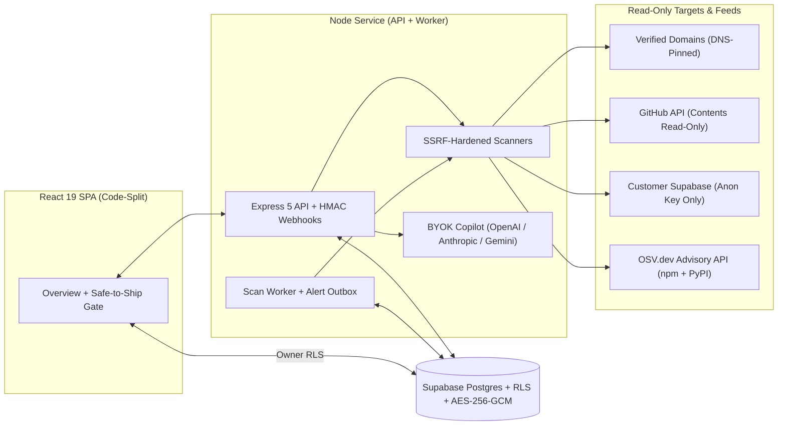

<p align="center">
  <picture>
    <source media="(prefers-color-scheme: dark)" srcset="docs/assets/bulwark-logo-dark.svg" />
    <source media="(prefers-color-scheme: light)" srcset="public/bulwark-logo.svg" />
    
  </picture>
</p>

<p align="center">
  <strong>External security posture &amp; Safe-to-Ship monitor for builders who ship fast.</strong>
</p>

<p align="center">
  <a href="https://github.com/Astraa14/bulwark/actions/workflows/ci.yml"></a>
  =22.6" />
  
  
  
</p>

<p align="center">
  <a href="https://bulwarksecure.vercel.app"><strong>Launch App ↗</strong></a> ·
  <a href="docs/USER_GUIDE.md"><strong>User Guide</strong></a> ·
  <a href="PRODUCT_SCOPE.md"><strong>Check Matrix &amp; Scope</strong></a> ·
  <a href="supabase/customer/bulwark_check_rls.sql"><strong>Supabase RLS Helper SQL</strong></a> ·
  <a href="SECURITY.md"><strong>Security Policy</strong></a>
</p>

---

## Why Bulwark Exists

Modern hosting platforms (Vercel, Cloudflare, Render) already handle TLS certificates and basic HTTP plumbing automatically. Yet indie products and AI-assisted ("vibe-coded") apps get compromised on launch day in predictable ways that traditional enterprise scanners miss:

- **Public database exposure** — Frontend bundles ship a public Supabase `anon` key while tables or custom Postgres RPCs lack Row Level Security.
- **Wallet-drain endpoints** — AI-generated `/api/*` routes or `"use server"` actions invoke OpenAI, Anthropic, Gemini, or Replicate with no authentication check or rate limit.
- **Payment & webhook forgery** — Stripe or Clerk webhook routes parse `req.json()` and upgrade accounts without cryptographic signature verification.
- **Dev-to-prod leaks** — `NEXT_PUBLIC_*` / `VITE_*` variables exposing server secrets, publicly downloadable `.js.map` source maps, secrets deleted in a follow-up commit without rotation, or `pk_test_` Stripe keys running on production domains.

**Bulwark** inspects across all three layers of a modern web app — **Live Website**, **GitHub Repository**, and **Supabase Backend** — using strictly **read-only** access, translates findings into plain-English blast radius, and separates true **Ship-Blockers** from lower-urgency **Post-Launch Hardening**.

> *"Bulwark finds and explains risks it can verify — and explicitly states what it could not check."* — [Product Scope](PRODUCT_SCOPE.md)

---

## Quick Start for Bulwark Users (5 Minutes)

Using the hosted app at **[bulwarksecure.vercel.app](https://bulwarksecure.vercel.app)** (full walkthrough in **[docs/USER_GUIDE.md](docs/USER_GUIDE.md)**):

1. **Check your live domain** — Go to **Sites → + Add site**, verify ownership with a `_bulwark.<domain>` DNS `TXT` record or `<meta name="bulwark-verify" ...>` tag, and tag your framework stack (`Next.js / Vercel`, `Vite / Render`, `Cloudflare`, `Express`, `Supabase`). Bulwark scans headers, TLS, DNS/SPF/DMARC, exposed files/source maps, and **automatically checks any public Supabase project bundled in your JS**.
2. **Connect GitHub (read-only)** — Create a Fine-Grained GitHub PAT scoped only to your target repos with **`Contents: Read-only`** (`Metadata: Read-only`), add it under **Integrations → Platform connections**, and optionally attach the signed push webhook or daily/weekly OSV schedule.
3. **Connect Supabase (zero SQL required)** — Paste your Project Ref and **publishable/`anon` key** (`service_role` keys are refused). Bulwark immediately checks Storage buckets, exposed PostgREST tables/RPCs, and `anon` row visibility using zero-row `HEAD` probes. For full policy-level RLS coverage, run [`bulwark_check_rls.sql`](supabase/customer/bulwark_check_rls.sql) once in your Supabase SQL Editor.
4. **Fix & verify in your AI editor** — Check your **Safe to Ship?** verdict on **Overview**. Open any blocker, click **Copy fix prompt for AI editor** (paste into Cursor, Claude Code, Lovable, Bolt, or Antigravity), deploy, and click **Re-check now** to verify it resolved.
5. **Turn on quiet monitoring** — Enable **Slack**, **Discord**, or **Email** alerts (plus the optional **Weekly Posture Digest**) in **Integrations → Alerts**.

---

## Detection Coverage Across 3 Layers

| Layer | What Bulwark Verifies | Vibe-Coder Differentiators |
|---|---|---|
| **1. Live Website** (`server/checks.mjs`) | Two-strike anti-flap HTTPS uptime, TLS expiry + self-signed / hostname-mismatch / untrusted-chain checks, DNS (`NS`, `MX`, `SPF`, `DMARC`), RDAP domain expiry, `HSTS`/`CSP`/framing/cookie flags, wildcard & reflected CORS, exposed `.env`/`.git`/SQL dumps, `.js.map` source maps, `/openapi.json` & `/graphql` introspection, homepage defacement drift | **Follows lazy-loaded SPA chunks** (`import("./chunk.js")`), **subdomain takeover detection** (dangling `CNAME`), **auto-discovers public Supabase & Firebase databases** from JS bundles with zero-payload exposure probes, catches 16 secret formats (incl. `postgres://` URIs, `sb_secret_`, Groq, Resend, Stripe), and flags live `pk_test_` keys on prod domains |
| **2. GitHub Repository** (`server/github.mjs`) | Security-priority file ordering + rate-limit retry, 18 secret patterns + **bounded 10-commit history** scan, [OSV](https://osv.dev) advisories across `package-lock.json`, `pnpm-lock.yaml`, `yarn.lock`, `requirements.txt`, `poetry.lock`, and `uv.lock` (up to 3 MB), root Dockerfiles, `pull_request_target`, `permissions: write-all`, mutable `@main` Actions | Flags **unauthenticated metered AI routes** (wallet drain), **unsigned Stripe/Clerk/webhook handlers**, **SSRF proxy routes**, **`jwt.decode` without verify**, **interpolated raw SQL & shell `exec` injection**, open `firestore.rules` (`allow write: if true`), `NEXT_PUBLIC_*`/`VITE_*` secret env names, `verify_jwt = false` Edge Functions using `service_role`, cross-file migrations missing RLS, and `.gitignore` missing `.env*` |
| **3. Supabase Project** (`server/supabase.mjs`) | Connectivity, public Storage buckets, optional policy-level RLS inspection via [`bulwark_check_rls.sql`](supabase/customer/bulwark_check_rls.sql), scheduled background re-scans | **Zero-SQL-helper `anon` surface audit** (PostgREST OpenAPI, custom `/rpc/*`, and `HEAD ?limit=1` zero-row count probes) + **`/auth/v1/settings` audit** catching unverified email `autoconfirm` and anonymous JWT escalation |

---

## System Architecture



---

## Security & Reliability Engineering

Bulwark is built to be audited:

- **Zero Write Permissions** — GitHub OAuth is identity-only; repository scanning uses a fine-grained read-only token, and Supabase connections reject `service_role` and `sb_secret_` keys before making any request.
- **DNS-Pinned SSRF Defense** — Outbound scanner requests allow only ports `80`/`443`, block loopback/RFC1918/CGNAT/link-local/cloud-metadata IPv4 & IPv6 ranges, pin resolved public IPs at the socket layer to prevent DNS rebinding, re-validate every redirect hop, and enforce hard byte caps.
- **Encryption at Rest with Key Rotation** — User BYOK keys (`$0` token markup), platform tokens, and alert webhooks are encrypted server-side with **AES-256-GCM** (`BULWARK_ENCRYPTION_KEY` + `BULWARK_ENCRYPTION_KEY_OLD` seamless rotation) and never returned to the browser.
- **Strict Tenant Isolation & Atomic Persistence** — Every table enforces owner-scoped Postgres Row Level Security (`auth.uid() = user_id`). Scan results, check outcomes, finding deduplication, and snooze expiry run inside single-transaction `SECURITY DEFINER` RPCs (`persist_scan_result`, `persist_platform_scan_result`) keyed by deterministic UUIDv5 scan slots.
- **Explicit Coverage Honesty** — Every check reports `pass`, `finding`, `not_checked`, or `error`. Incomplete or errored checks mark the scan `partial` rather than silently claiming "clean."
- **Accurate Finding Lifecycle** — Fixed findings auto-resolve on the next scan even when an unrelated check was skipped (e.g. the optional RLS helper is not installed), regressions and expired snoozes re-alert, and every manual **Re-check now** runs as a fresh scan.
- **Operational Readiness** — `GET /api/health` verifies database connectivity and encryption-key configuration and reports the last worker heartbeat; API and worker shut down gracefully so in-flight scans release their leases.
- **Your Data, Your Call** — **Settings → Danger zone** permanently deletes every site, scan, finding, encrypted credential, and the account itself.

---

## Project Structure

```text
├── docs/
│   └── USER_GUIDE.md           # End-to-end onboarding, setup & troubleshooting guide
├── src/
│   ├── App.tsx                 # Lazy-loaded SPA shell & URL router
│   ├── components/             # Shell, Modal, UI primitives, GitHub/Supabase connectors
│   ├── pages/                  # Overview, Sites, Threats, ThreatDetail, Scans, Reports,
│   │                           # Integrations, AiCopilot, ApiKeys, Settings
│   └── lib/                    # Router, stack-aware fix-prompt builder, scan outcome helpers
├── server/
│   ├── app.mjs                 # Express 5 API, auth guards, rate limits, webhook ingress
│   ├── worker.mjs              # Due-scan claim loop, platform job runner, alert outbox drain
│   ├── checks.mjs              # SSRF-hardened external website & bundle scanner
│   ├── github.mjs              # GitHub tree/history, OSV lockfile & vibe-code footgun scanner
│   ├── supabase.mjs            # Zero-helper PostgREST anon surface & storage/RLS scanner
│   ├── alerts.mjs              # Slack, Discord, Resend email & weekly digest outbox
│   ├── ai.mjs                  # BYOK OpenAI, Anthropic & Google Gemini client
│   └── *.test.mjs              # 176 unit, SSRF, tenant-isolation, migration & UI helper tests
├── supabase/
│   ├── migrations/             # 19 ordered, idempotent SQL migrations
│   ├── apply_all.sql           # Generated single-file schema bundle (`npm run db:apply-all`)
│   └── customer/               # Optional read-only RLS metadata helper for customer projects
└── render.yaml                 # Single-service API + worker deployment blueprint
```

---

## Documentation
- **[User Guide (`docs/USER_GUIDE.md`)](docs/USER_GUIDE.md)** — Step-by-step setup for websites, GitHub PATs/webhooks, Supabase keys/RLS helper, AI Copilot, alerts, and account deletion.
- **[Product Scope (`PRODUCT_SCOPE.md`)](PRODUCT_SCOPE.md)** — Exact check matrix, trust boundaries, data handling, and explicit non-goals.
- **[Security Policy (`SECURITY.md`)](SECURITY.md)** — Security architecture and private vulnerability reporting.
