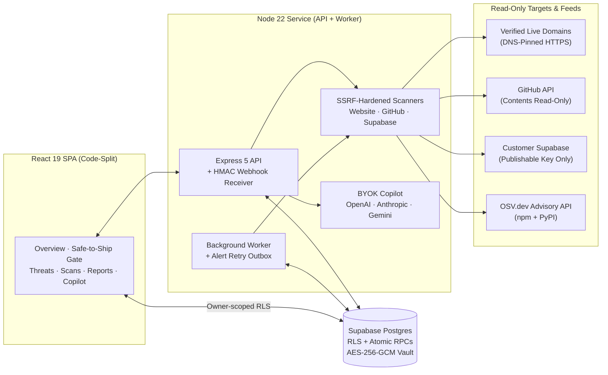

<p align="center">
  
</p>

<p align="center">
  <strong>External security posture &amp; Safe-to-Ship monitor for builders who ship fast.</strong>
</p>

<p align="center">
  <a href="https://github.com/Astraa14/bulwark/actions/workflows/ci.yml"></a>
  =22.6" />
  
  
  
</p>

---

## Why Bulwark Exists

Modern hosting platforms (Vercel, Cloudflare, Render) already handle TLS certificates and basic HTTP plumbing automatically. Yet indie products and AI-assisted ("vibe-coded") apps get compromised on launch day in predictable ways that traditional enterprise scanners miss:

- **Public database exposure** — Frontend bundles ship a public Supabase `anon` key while tables or RPCs lack Row Level Security.
- **Wallet-drain endpoints** — AI-generated `/api/*` routes or `"use server"` actions invoke OpenAI, Anthropic, Gemini, or Replicate with no authentication check or rate limit.
- **Payment & webhook forgery** — Stripe or Clerk webhook routes parse `req.json()` and upgrade accounts without cryptographic signature verification.
- **Dev-to-prod leaks** — `NEXT_PUBLIC_*` / `VITE_*` variables exposing server secrets, publicly downloadable `.js.map` source maps, secrets deleted in a follow-up commit without rotation, or `pk_test_` Stripe keys running on production domains.

**Bulwark** inspects across all three layers of a modern web app — **Live Website**, **GitHub Repository**, and **Supabase Backend** — using strictly **read-only** access, translates findings into plain-English blast radius, and separates true **Ship-Blockers** from lower-urgency **Post-Launch Hardening**.

> *"Bulwark finds and explains risks it can verify — and explicitly states what it could not check."* — [Product Scope](PRODUCT_SCOPE.md)

---

## System Architecture



---

## Detection Coverage Across 3 Layers

| Layer | What Bulwark Verifies | Vibe-Coder Differentiators |
|---|---|---|
| **1. Live Website** (`server/checks.mjs`) | TLS validity/expiry, DNS (`NS`, `MX`, `SPF`, `DMARC`), RDAP domain expiry, `HSTS`/`CSP`/cookie flags, wildcard & reflected CORS, exposed `.env`/`.git`/SQL dumps, `.js.map` source maps, `/openapi.json` & `/graphql` introspection, homepage defacement drift | **Auto-discovers public Supabase projects** from frontend JS bundles and runs zero-row `HEAD` probes for `anon`-readable tables; flags live `pk_test_` Stripe keys on production domains |
| **2. GitHub Repository** (`server/github.mjs`) | Hardcoded secrets + **bounded 10-commit history** scan, [OSV](https://osv.dev) advisories across `package-lock.json`, `pnpm-lock.yaml`, `yarn.lock`, `requirements.txt`, `poetry.lock`, and `uv.lock` (up to 3 MB), root Dockerfiles, `pull_request_target`, `permissions: write-all`, mutable `@main` Actions | Flags **unauthenticated metered AI routes** (wallet drain), **unsigned Stripe/Clerk/webhook handlers**, `NEXT_PUBLIC_*`/`VITE_*` secret env names, `verify_jwt = false` Edge Functions using `service_role`, cross-file `supabase/migrations/*.sql` missing RLS, and `.gitignore` missing `.env*` |
| **3. Supabase Project** (`server/supabase.mjs`) | Connectivity, public Storage buckets, optional policy-level RLS inspection via [`bulwark_check_rls.sql`](supabase/customer/bulwark_check_rls.sql), scheduled background re-scans | **Zero-SQL-helper `anon` surface audit**: inspects PostgREST OpenAPI exposure, custom `/rpc/*` functions, and `HEAD ?limit=1` row counts (**0 bytes** of customer table data read) |

---

## Close-the-Loop Workflow

1. **"Safe to Ship?" Launch Verdict** — Overview categorizes open findings into **Ship-Blockers** (*hold before sharing publicly*) vs. **Polish Later** (*defense-in-depth hardening*), paired with a 1-sentence plain-English blast-radius summary on every finding.
2. **1-Click AI Editor Fix Prompts** — Generates a redacted, framework-tailored prompt (`Next.js / Vercel`, `Vite / Render`, `Cloudflare`, `Express`, `Supabase`) ready to paste into Cursor, Claude Code, Windsurf, or Antigravity.
3. **BYOK AI Copilot (\$0 Markup)** — Optional plain-English explanations and weekly Top-3 priority briefs powered by the user's own **OpenAI**, **Anthropic**, or **Google Gemini** API key (cached per finding; deterministic 0-token fallback included).
4. **Verify & Triage** — 1-click **Re-check now** re-scans the owning site, repo, or Supabase project to confirm fixes immediately; temporary **7d / 30d / 90d snooze** with triage notes automatically reopens findings if still present after expiry.
5. **Transactional Outbox Alerts** — Multi-channel notifications (**Slack**, **Discord**, **Resend Email**, plus optional **Weekly Posture Digest**) backed by a database retry outbox (`alert_deliveries`) with exponential backoff.

---

## Security & Reliability Engineering

Bulwark is built to be audited:

- **Zero Write Permissions** — GitHub OAuth is identity-only; repository scanning uses a fine-grained read-only token, and Supabase connections reject `service_role` and `sb_secret_` keys before making any request.
- **DNS-Pinned SSRF Defense** — Outbound scanner requests allow only ports `80`/`443`, block loopback/RFC1918/CGNAT/link-local/cloud-metadata IPv4 & IPv6 ranges, pin resolved public IPs at the socket layer to prevent DNS rebinding, re-validate every redirect hop, and enforce hard byte caps.
- **Encryption at Rest with Key Rotation** — User BYOK keys, platform tokens, and alert webhooks are encrypted server-side with **AES-256-GCM** (`BULWARK_ENCRYPTION_KEY` + `BULWARK_ENCRYPTION_KEY_OLD` seamless rotation) and never returned to the browser.
- **Strict Tenant Isolation & Atomic Persistence** — Every table enforces owner-scoped Postgres Row Level Security (`auth.uid() = user_id`). Scan results, check outcomes, finding deduplication, and snooze expiry run inside single-transaction `SECURITY DEFINER` RPCs (`persist_scan_result`, `persist_platform_scan_result`) keyed by deterministic UUIDv5 scan slots.
- **Explicit Coverage Honesty** — Every check reports `pass`, `finding`, `not_checked`, or `error`. Incomplete or errored checks mark the scan `partial` rather than silently claiming "clean."

---

## Project Structure

```text
├── src/
│   ├── App.tsx                 # Lazy-loaded SPA shell & URL router
│   ├── components/             # Shell, Modal, UI primitives, GitHub/Supabase connectors
│   ├── pages/                  # Overview, Sites, Threats, ThreatDetail, Scans, Reports,
│   │                           # Integrations, AiCopilot, ApiKeys, Settings
│   └── lib/                    # Router, stack-aware fix-prompt builder, scan outcome helpers
├── server/
│   ├── app.mjs                 # Express 5 API, auth guards, rate limits, webhook ingress
│   ├── worker.mjs              # Due-scan claim loop, platform job runner, alert outbox drain
│   ├── checks.mjs              # SSRF-hardened external website & bundle scanner
│   ├── github.mjs              # GitHub tree/history, OSV lockfile & vibe-code footgun scanner
│   ├── supabase.mjs            # Zero-helper PostgREST anon surface & storage/RLS scanner
│   ├── alerts.mjs              # Slack, Discord, Resend email & weekly digest outbox
│   ├── ai.mjs                  # BYOK OpenAI, Anthropic & Google Gemini client
│   └── *.test.mjs              # 154 unit, SSRF, tenant-isolation, migration & UI helper tests
├── supabase/
│   ├── migrations/             # 19 ordered, idempotent SQL migrations
│   ├── apply_all.sql           # Generated single-file schema bundle (`npm run db:apply-all`)
│   └── customer/               # Optional read-only RLS metadata helper for customer projects
└── render.yaml                 # Single-service API + worker deployment blueprint
```

---

## Getting Started Locally

### Prerequisites
- **Node.js `>= 22.6`**
- A **Supabase** project (for authentication, RLS-protected storage, and scan job queues)

### 1. Install dependencies
```bash
npm install
```

### 2. Configure environment
Copy [`.env.example`](.env.example) to `.env.local` and fill in your Supabase URL, publishable anon key, service-role key, and a random 32+ character `BULWARK_ENCRYPTION_KEY`:

```bash
cp .env.example .env.local
```

Apply [`supabase/apply_all.sql`](supabase/apply_all.sql) once in your Supabase project's **SQL Editor**.

### 3. Run in development
```bash
# Terminal 1: Vite frontend (http://localhost:8443)
npm run dev

# Terminal 2: Express API (http://127.0.0.1:8787)
npm run api

# Terminal 3: Background scan & alert worker
npm run worker
```

> **Tip:** Without `.env.local`, the frontend boots cleanly in interactive **demo mode** for UI previewing.

### 4. Run checks & test suite
```bash
npx tsc --noEmit      # Typecheck frontend & Vite config
npm run db:check      # Verify supabase/apply_all.sql matches migrations
npm test              # Run all 154 automated tests
npm run build         # Build code-split production bundle
```

---

## Documentation
- **[PRODUCT_SCOPE.md](PRODUCT_SCOPE.md)** — Exact check matrix, trust boundaries, data handling, and explicit non-goals.
- **[SECURITY.md](SECURITY.md)** — Security architecture and vulnerability disclosure policy.
- **[render.yaml](render.yaml)** — Production deployment configuration and network egress recommendations.
